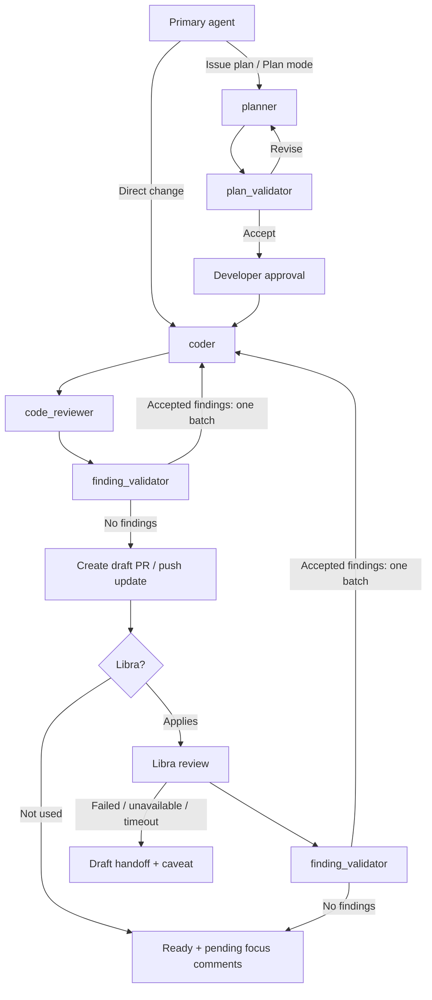

# Agent configuration

Global instructions, role definitions, and role skills for Codex and Claude Code. Each tool loads them through absolute symlinks into this repository.

Codex reads:

- `/Users/<user>/.codex/AGENTS.md` → `/Users/<user>/agent-config/codex/AGENTS.md`
- `/Users/<user>/.codex/agents` → `/Users/<user>/agent-config/codex/agents`
- `/Users/<user>/.agents/skills/<skill>` → `/Users/<user>/agent-config/skills/<skill>` for each role skill

Claude Code reads:

- `/Users/<user>/.claude/CLAUDE.md` → `/Users/<user>/agent-config/claude/CLAUDE.md`
- `/Users/<user>/.claude/agents` → `/Users/<user>/agent-config/claude/agents`
- `/Users/<user>/.claude/skills/<skill>` → `/Users/<user>/agent-config/skills/<skill>` for each role skill

`claude/CLAUDE.md` is a relative symlink to `../codex/AGENTS.md` (resolved from the link's own directory, so the absolute `~/.claude/CLAUDE.md` link chains through it), so both tools load one global instruction file; edit `codex/AGENTS.md`, not through the link. `skills/` holds the one copy of each role's instructions.

Create the links before starting a session, and start a fresh session in either tool after changes so it loads the updated instructions, agent definitions, and skills. This repository does not change the primary model, concurrency, or other `config.toml` or `settings.json` settings.

## Workflow

The primary agent coordinates the fixed roles for repository changes and interacts with the developer. See `codex/AGENTS.md` for the orchestration; its `Tool mechanics` section holds that file's only tool-specific lines. Each role's instructions live in `skills/<skill>/SKILL.md` in the [Agent Skills](https://agentskills.io) format, which both tools read. `codex/agents/*.toml` and `claude/agents/*.md` are lean definitions that set the model and reasoning effort, load the role skill, and carry only harness-specific mechanics. The `code-reviewer` skill defines a Markdown review format with P0–P3 priorities that both harnesses return. Tune a role's stable instructions in its skill and keep task-specific facts in assignments.

| Role | Skill | Responsibility |
| --- | --- | --- |
| `planner` | `planner` | Planning with repository-specific guidance; Codex adds its native Plan-mode guidance |
| `plan_validator` | `plan-validator` | Independent scope, integration, and duplication checks |
| `coder` | `coder` | Bounded implementation, reuse, and proportional validation |
| `code_reviewer` | `code-reviewer` | Scope and semantic duplication checks; Codex adds its native review rubric, Claude Code its bundled `code-review` skill |
| `finding_validator` | `finding-validator` | Verification of reviewer findings and accept/reject decisions |

Each skill uses short bullets grouped by responsibility and follows the shared [Global contract](codex/AGENTS.md#global-contract), which both tools load into every role. The Codex planner reads the live [native Plan-mode guidance](https://github.com/openai/codex/blob/main/codex-rs/collaboration-mode-templates/templates/plan.md); the Codex reviewer reads the live [native review rubric](https://github.com/openai/codex/blob/main/codex-rs/prompts/templates/review/rubric.md). These are bundled defaults; active session instructions take precedence. Reading the sources does not change modes or tools. An unreadable source is reported as a blocker.

The workflow allows three plan corrections, three local review correction rounds per cycle, and three Libra correction rounds per PR. Each Libra review's accepted findings form one coder batch, followed by its complete local review cycle and one push. That batch consumes one Libra round and resets only the local counter to round one, leaving two additional local corrections. The Libra count persists across heads.

Libra is optional: repositories without it can become ready for human review after local review completes, with an explicit local-review outcome. Both completion paths produce pending inline focus comments for the developer.

## Role definitions

Codex definitions set `model = "gpt-6.1-sol"` and `model_reasoning_effort`; Claude Code definitions set `model: opus` and `effort`. `planner`, `coder`, and `code_reviewer` use `xhigh`; `plan_validator` and `finding_validator` use `high`. Read-only Claude Code roles set `disallowedTools: Edit, Write, NotebookEdit`. Skill names use hyphens as the Agent Skills spec requires; agent names keep underscores.

## Claude Code notes

- Targets Claude Code 2.1.308 in the desktop Code tab. Cowork sessions skip a symlinked `~/.claude/CLAUDE.md` and do not read `~/.claude/skills`. Cloud sessions, including cloud scheduled tasks, read none of `~/.claude/CLAUDE.md`, `~/.claude/agents`, or `~/.claude/skills`, so these roles are unavailable there unless a repository commits them under its own `.claude/`.
- Role reviews run `/code-review xhigh --max-findings all`, which also becomes the remembered default for your own `/code-review` runs; pass a level and `--max-findings default` to reset it.
- Optional user settings, not shipped by this repository: `CLAUDE_CODE_FORK_SUBAGENT=0` turns fork mode off, so the primary can wait for a role subagent in the foreground and never starts a fork on its own; `"permissions": {"deny": ["Agent(fork)"]}` blocks forks only and leaves fork mode on, so role subagents stay background-only in desktop sessions (role subagents start fresh from their definition either way); `CLAUDE_CODE_DISABLE_EXPLORE_PLAN_AGENTS=1` if the primary keeps using the built-in planning subagents; `claudeMdExcludes` for the nested loads of `claude/CLAUDE.md` and `codex/AGENTS.md` when working inside this repository.
