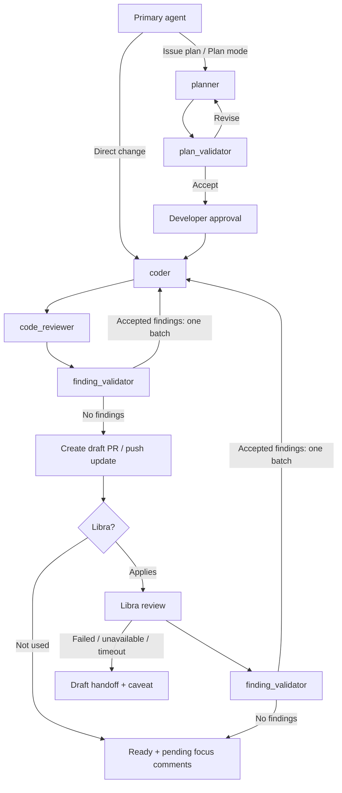

# Codex configuration

Codex reads these absolute symlinks:

- `/Users/<user>/.codex/AGENTS.md` → `/Users/<user>/codex-config/codex/AGENTS.md`
- `/Users/<user>/.codex/agents` → `/Users/<user>/codex-config/codex/agents`

Start a fresh Codex session after changes so it loads the updated instructions and agent definitions. This repository does not change the primary model, concurrency, or other `config.toml` settings.

## Workflow

The primary agent coordinates the fixed roles in `codex/agents/` for repository changes and interacts with the developer. See `codex/AGENTS.md` for the orchestration. Tune each role's stable instructions in its TOML definition and keep task-specific facts in assignments.

| Role | Responsibility |
| --- | --- | --- |
| `planner` | Native Codex planner with additional guidance |
| `plan_validator` | Independent scope, integration, and duplication checks |
| `coder` | Bounded implementation, reuse, and proportional validation |
| `code_reviewer` | Native Codex review plus scope and semantic duplication checks |
| `finding_validator` | Verification of reviewer findings and accept/reject decisions |

Each role uses short bullets grouped by responsibility and links to the shared [Global contract](codex/AGENTS.md#global-contract). The planner reads the live [native Plan-mode guidance](https://github.com/openai/codex/blob/main/codex-rs/collaboration-mode-templates/templates/plan.md); the reviewer reads the live [native review rubric](https://github.com/openai/codex/blob/main/codex-rs/prompts/templates/review/rubric.md). These are bundled defaults; active session instructions take precedence. Reading the sources does not change modes or tools. An unreadable source is reported as a blocker.

The workflow allows three plan corrections, three local review correction rounds per cycle, and three Libra correction rounds per PR. Each Libra review's accepted findings form one coder batch, followed by its complete local review cycle and one push. That batch consumes one Libra round and resets only the local counter to round one, leaving two additional local corrections. The Libra count persists across heads.

Libra is optional: repositories without it can become ready for human review after local review completes, with an explicit local-review outcome. Both completion paths produce pending inline focus comments for the developer. 
