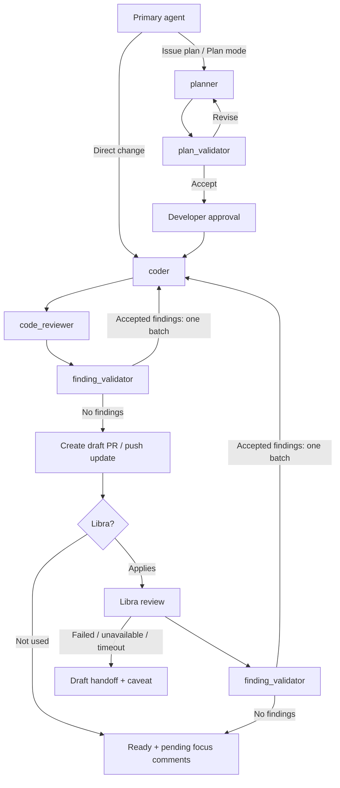

# Agent configuration

Global instructions, role definitions, and role skills for Codex and Claude Code. Each tool loads them through absolute symlinks into this repository.

Codex reads:

- `/Users/<user>/.codex/AGENTS.md` → `/Users/<user>/agent-config/codex/AGENTS.md`
- `/Users/<user>/.codex/agents` → `/Users/<user>/agent-config/codex/agents`
- `/Users/<user>/.agents/skills/<skill>` → `/Users/<user>/agent-config/skills/<skill>` for each role skill

Claude Code reads:

- `/Users/<user>/.claude/CLAUDE.md` → `/Users/<user>/agent-config/claude/CLAUDE.md`
- `/Users/<user>/.claude/agents` → `/Users/<user>/agent-config/claude/agents`
- `/Users/<user>/.claude/skills/<skill>` → `/Users/<user>/agent-config/skills/<skill>` for each role skill

`claude/CLAUDE.md` is a relative symlink to `../codex/AGENTS.md` (resolved from the link's own directory, so the absolute `~/.claude/CLAUDE.md` link chains through it), so both tools load one global instruction file; edit `codex/AGENTS.md`, not through the link. `skills/` holds the one copy of each role's instructions.

Create the links before starting a session, and start a fresh session in either tool after changes so it loads the updated instructions, agent definitions, and skills. This repository does not change the primary model, concurrency, or other `config.toml` or `settings.json` settings.

## Workflow

The primary agent coordinates the fixed roles for repository changes and interacts with the developer. See `codex/AGENTS.md` for the orchestration; its `Tool mechanics` section holds that file's only tool-specific lines. Each role's instructions live in `skills/<skill>/SKILL.md` in the [Agent Skills](https://agentskills.io) format, which both tools read. `codex/agents/*.toml` and `claude/agents/*.md` are lean definitions that set the model and reasoning effort, load the role skill, and carry only harness-specific mechanics.

| Role | Responsibility |
| --- | --- |
| `planner` | Planning with repository-specific guidance; Codex adds its native Plan-mode guidance |
| `plan_validator` | Independent scope, integration, and duplication checks |
| `coder` | Bounded implementation, reuse, and proportional validation |
| `code_reviewer` | Scope and semantic duplication checks; Codex adds its native review rubric, Claude Code its bundled `code-review` skill |
| `finding_validator` | Verification of reviewer findings and accept/reject decisions |

The workflow allows three plan corrections, three local review correction rounds per cycle, and three Libra correction rounds per PR. Each Libra review's accepted findings form one coder batch, followed by its complete local review cycle and one push. That batch consumes one Libra round and resets only the local counter to round one, leaving two additional local corrections. The Libra count persists across heads.

Libra is optional: repositories without it can become ready for human review after local review completes, with an explicit local-review outcome. Both completion paths produce pending inline focus comments for the developer.
